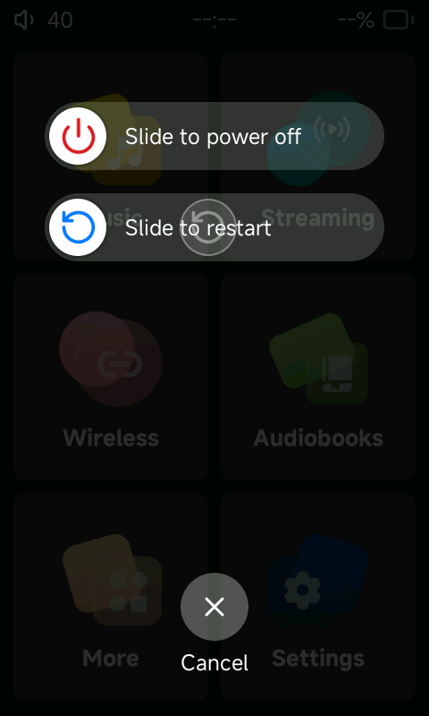
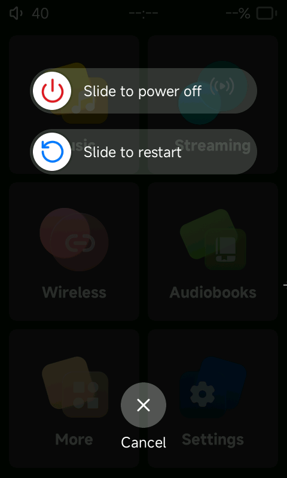
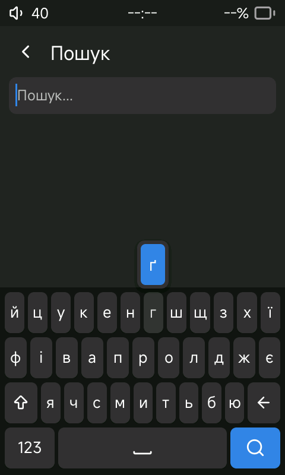
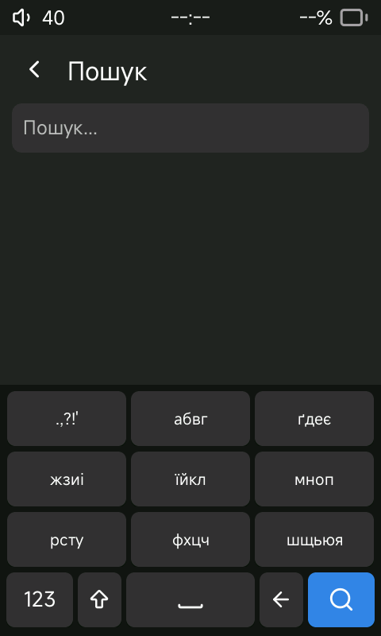
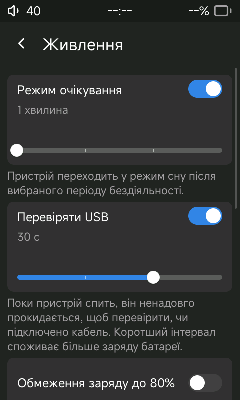

# SonixOS — Ukrainian Glass Animation Mod

An unofficial community modification of SonixOS 1.3.0
for the HiBy R1 digital audio player.

## Base project

This modification is based on CookieCaptainD's integration
build from November 18, 2026.

- Base branch: integration/r1-all-cookiecaptaind
- Base commit: 225623c94302fc3e3d67a34eab0ca78dc7ab584f
- Modified branch: ukrainian-glass-mod
- Target device: HiBy R1

## Animated glass power menu

The shutdown and restart sliders now feature animated,
translucent glass indicators.

- Left-aligned shutdown and restart labels.
- Monochrome animated ghost slider indicators.
- Quadratic opacity fade.
- Animation pauses during user interaction.
- Animation restarts after an incomplete swipe.
- Animation stops when the power menu is closed.

### Animation parameters

| Parameter | Value |
|---|---|
| Initial layered opacity | 75% |
| Glass background opacity | 22% |
| Glass border opacity | 65% |
| Border width | 2 px |
| Timer interval | 16 ms |
| Movement duration | 1500 ms |
| Restart slider delay | 750 ms |
| Full animation cycle | 4000 ms |
| Pause between cycles | 1750 ms |

## Ukrainian QWERTY keyboard

Added the missing Ukrainian letters through long press:

- г → ґ
- Г → Ґ

The Ukrainian keyboard remains a separate selectable layout.

The long-press variant table is shared between layouts,
so these variants may also be available on other
Cyrillic keyboards.

## Ukrainian T9 keyboard

Restored the missing letter Е and redistributed all
33 Ukrainian letters in alphabetical order.

| Key | Lowercase | Uppercase |
|---|---|---|
| 2 | абвг | АБВГ |
| 3 | ґдеє | ҐДЕЄ |
| 4 | жзиі | ЖЗИІ |
| 5 | їйкл | ЇЙКЛ |
| 6 | мноп | МНОП |
| 7 | рсту | РСТУ |
| 8 | фхцч | ФХЦЧ |
| 9 | шщьюя | ШЩЬЮЯ |

Keys 2–8 contain four letters each.
Key 9 contains five letters.

## Ukrainian translation

Shortened the USB wake setting to "Перевіряти USB"
to better fit the interface and describe its function.

## Host simulator safety

Added HOST_BUILD safeguards to the power menu and
automatic shutdown function to prevent the tested
shutdown paths from powering off or rebooting
the host operating system.

Always run the simulator as a regular user.

## Building

Follow the original project's README for dependencies
and toolchain setup.

Desktop simulator:

    cd sonix-player
    make -j4 host
    ./sonix_player_host

MIPS target:

    make -j4 target

Tested build environment:

- Ubuntu WSL
- LVGL 9.6.0
- Rockbox GCC 9.5.0 MIPS toolchain
- MIPS32r2 target
- GLIBC 2.22 compatibility

## Verification

The experimental firmware image was produced by replacing
only the sonix_player executable inside an existing
working HiBy R1 SonixOS firmware image.

The original kernel, drivers, system resources,
filesystem ownership, permissions, extended attributes
and hardlinks were preserved.

Verification results:

- Desktop simulator: 20/20 functional checks passed.
- MIPS target compilation: passed.
- GLIBC compatibility check: passed.
- SquashFS content and metadata verification: passed.
- OTA chunk and MD5 chain verification: passed.
- Kernel modules: 30 checked, zero mismatches.
- CookieCaptainD verify_upt.sh: passed.
- RootFS NAND reserve: 20 erase blocks.
- Kernel NAND reserve: 17 erase blocks.

Physical-device testing: not yet reported.

## Important

This is an unofficial experimental modification,
not an official HiBy firmware release.

Firmware installation carries a risk of rendering
the device unusable. Keep a known-working firmware
image and an appropriate recovery method available.

The source code is provided under the original
project's GNU GPL v3.0 license terms.

Third-party firmware components may be subject
to separate licensing conditions.

## Credits

Many thanks to the original SonixOS developers,
CookieCaptainD, and all community contributors.

Original integration project:
https://github.com/CookieCaptainD/sonix-player

Ukrainian Glass Animation Mod:
https://github.com/navitanh-hash/sonix-player

Feedback, suggestions and contributions are welcome.

## Demonstration

The following demonstrations were captured directly
from the SDL2 host simulator running the modified
Sonix Player interface at the native HiBy R1
resolution of 480 x 800 pixels.

### Animated Glass Power Menu

| Automatic animation | Touch interaction |
| :---: | :---: |
|  |  |

The translucent ghost sliders demonstrate the direction
of movement. The animation pauses during user interaction
and resumes after an incomplete swipe.

### Ukrainian Language Improvements

| Ukrainian QWERTY | Ukrainian T9 | USB wake setting |
| :---: | :---: | :---: |
|  |  |  |
| Long-press support for Ґ / ґ | Complete Ukrainian alphabet | Shortened Ukrainian translation |

These demonstrations show the host simulator.
Physical-device compatibility has not yet been confirmed.
