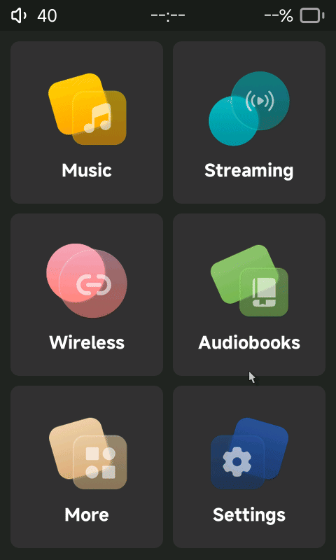

# Interactive Power Menu v1.1.0

An enhanced iOS-inspired power menu for SonixOS on
the HiBy R1, combining animated gesture guidance
with seamless interactive controls.

## Demonstration

## Features

- Alternating power-off and restart slider animations.
- Smooth forward movement with a double damped
  spring rebound.
- Seamless takeover of the moving knob during
  any phase of its animation.
- No position jump when grabbing the moving knob.
- Independent animation of the other slider
  during manual interaction.
- Double spring rebound after an incomplete
  manual gesture.
- Adaptive rebound amplitude for short gestures.
- Protection against accidental shutdown or restart.
- Improved text alignment.
- Clean appearance without additional outlines.
- Language-independent gesture handling.

## Animation parameters

| Parameter | Value |
|---|---:|
| Automatic displacement | 94 px |
| Forward movement | 600 ms |
| Automatic return | 105 ms |
| First rebound | 16 px |
| First rebound duration | 160 ms |
| Second rebound | 4 px |
| Second rebound duration | 95 ms |
| Initial delay | 500 ms |
| Animation cycle | 4200 ms |
| Manual return | 220 ms |
| Manual return with rebounds | 475 ms |
| Minimum intentional drag | 12 px |
| Confirmation threshold | 88% |

## Safety

Automatic animation cannot trigger a power action.

An action requires an intentional manual drag
followed by a release beyond the confirmation
threshold. Lost touch contact cancels the gesture.

The original shutdown and restart functions
remain unchanged.

## Testing

**The final firmware build has been successfully
tested on a physical HiBy R1.**

The implementation has also been successfully
tested in the SDL2 host simulator.

The demonstration GIF is an actual recording
of the host simulator, not a generated animation.

## Integration

Reference repository:

https://github.com/navitanh-hash/sonix-player

Reference base commit:

9c85b729164f9def0ca4fb000e662ca2fef1a7ec

The patch modifies only:

    sonix-player/src/gui/shell/powermenu.c

Clone the reference repository:

    git clone https://github.com/navitanh-hash/sonix-player.git
    cd sonix-player
    git checkout 9c85b729164f9def0ca4fb000e662ca2fef1a7ec

Download interactive-power-menu.patch from this
release and place it in the repository root.

Check and apply the patch:

    git apply --check interactive-power-menu.patch
    git apply interactive-power-menu.patch

Build the host simulator:

    cd sonix-player
    make -j4 host
    ./sonix_player_host

Build the target executable using the existing
SonixOS toolchain:

    make -j4 target

Follow the repository's existing firmware packing
instructions to create a compatible HiBy R1 UPT.

For other SonixOS forks or revisions, inspect the
patch for compatibility before applying it.

## Distribution

This is a source-code-only modification intended
for developers and users who wish to integrate
the interactive power menu into their own
SonixOS builds.

No prebuilt firmware, executable binaries,
system images or original video recordings
are included in this release.

All original project licensing terms apply.

## Prebuilt firmware upon request

If anyone is interested in a ready-to-install
firmware with this modification already integrated,
feel free to contact me.

**I would be happy to build a complete firmware
image for the HiBy R1 and share it upon request.**

## License

This modification is distributed under the
GNU General Public License v3.

Modified by navitanh-hash on November 24, 2026.

Original copyright and licensing notices are retained.
See the included LICENSE file for the full license text.
